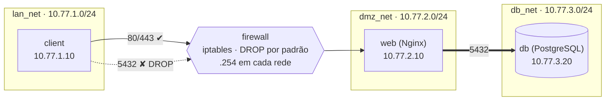

# Firewall Linux (Netfilter/iptables) com DMZ em Docker — CerradoShop

Trabalho Parcial de **Segurança da Informação** · Bacharelado em Sistemas de
Informação · IF Goiano — Campus Ceres · Prof. Roitier Campos Gonçalves.

Laboratório que simula, com **Docker Compose**, a infraestrutura segmentada de
uma loja virtual fictícia (a *CerradoShop*): uma rede interna (cliente), uma
**DMZ** com servidor web, um segmento isolado para o banco de dados e um
**firewall Linux com `iptables`** (política `DROP` por padrão) como único
caminho entre elas.

📄 **Relatório técnico completo:** [`docs/RELATORIO.md`](docs/RELATORIO.md)
(case, diagnóstico, matriz de regras e metodologia de testes).

---

## Arquitetura



| Container | Função | Rede(s) | IP(s) |
|---|---|---|---|
| `client` | Estação interna com `curl`, `nmap`, `nc`, `psql` | `lan_net` | 10.77.1.10 |
| `firewall` | Gateway/roteador + `iptables` (`cap_add: NET_ADMIN`) | `lan_net`, `dmz_net`, `db_net` | .254 em cada rede |
| `web` | Servidor Nginx (HTTP e HTTPS) | `dmz_net`, `db_net` | 10.77.2.10 · 10.77.3.10 |
| `db` | PostgreSQL 16 | `db_net` | 10.77.3.20 |

A rede do cliente **não** alcança os serviços sem passar pelo firewall, e as redes têm o NAT de saída desligado (enable_ip_masquerade: "false"), então o laboratório não tem saída para a internet.

---

## Como executar

**Pré-requisitos:** Docker Engine e Docker Compose v2.

```bash
git clone https://github.com/Matheus-fel/firewall-dmz-lab
cd firewall-dmz-lab

docker compose up -d --build     # sobe tudo; o firewall carrega as regras sozinho
docker compose ps                # aguarde firewall, db e web ficarem "healthy"
```

Nenhuma configuração manual é necessária: o `firewall/entrypoint.sh` descobre as
interfaces, confere o `ip_forward` e executa o `firewall/rules.sh`
automaticamente. As senhas de laboratório têm valores padrão no compose; para
mudá-las, copie `.env.example` para `.env`.

### Teste rápido

```bash
# Deve funcionar (retorna 200)
docker compose exec client curl -s -o /dev/null -w '%{http_code}\n' http://dmz-web

# Deve ser bloqueado (tempo esgotado, porta "filtered")
docker compose exec client nmap -Pn -p 5432 dmz-db
```

### Bateria completa de testes

```bash
./tests/run-tests.sh      # imprime PASS/FAIL; código de saída != 0 se algo falhar
```

O passo a passo detalhado (testes positivos e negativos, resultado esperado e
regra correspondente) está na **seção 4** do [relatório](docs/RELATORIO.md#4-metodologia-de-testes-e-validação).

### Encerrar

```bash
docker compose down        # mantém os dados do banco
docker compose down -v     # apaga também o volume do banco
```

---

## Regras do firewall (resumo)

Política padrão **DROP** em `INPUT`, `FORWARD` e `OUTPUT`. Liberações explícitas:

| Origem | Destino | Porta/Protocolo | Ação | Justificativa |
|---|---|---|---|---|
| Rede Cliente | Web (DMZ) | TCP 80 / 443 | ACCEPT | Acesso ao sistema |
| Rede Cliente | Web (DMZ) | ICMP echo (limitado) | ACCEPT | Diagnóstico |
| Rede Cliente | Banco | TCP 5432 | **DROP** | Cliente não acessa o banco direto |
| Rede Cliente | Demais portas | qualquer | **DROP** | Menor superfície de ataque |
| DMZ / Banco | Rede Cliente | novas conexões | **DROP** | Contém um servidor comprometido |
| Qualquer | Qualquer | `ESTABLISHED, RELATED` | ACCEPT | Respostas (firewall *stateful*) |

A tabela completa (com rótulos R1–R10, S1, I1–I2 e N1) está na **seção 3** do
[relatório](docs/RELATORIO.md#3-matriz-de-regras-de-segurança-firewall).

---

## Estrutura do repositório

```text
.
├── docker-compose.yml        # redes, serviços, volumes, capabilities, healthchecks
├── .env.example              # modelo de variáveis (senhas de laboratório)
├── client/
│   ├── Dockerfile            # Alpine + curl, nmap, nc, psql
│   └── entrypoint.sh         # cria as rotas via firewall
├── firewall/
│   ├── Dockerfile            # Alpine + iptables, iproute2, conntrack
│   ├── entrypoint.sh         # descobre interfaces, confere ip_forward, carrega regras
│   └── rules.sh              # AS REGRAS DO IPTABLES (comentadas)
├── web/
│   ├── Dockerfile            # Nginx + certificado autoassinado
│   ├── nginx.conf            # HTTP/HTTPS, cabeçalhos de segurança
│   └── html/index.html       # site de exemplo
├── db/
│   ├── pg_hba.conf           # só aceita o web (defesa em profundidade)
│   └── init/                 # esquema SQL e usuário de aplicação (menor privilégio)
├── tests/
│   └── run-tests.sh          # testes positivos/negativos automatizados
└── docs/
    └── RELATORIO.md          # relatório técnico (4 seções do enunciado)
```

---

## Decisões de projeto e limitações

- **Menor privilégio:** só o firewall (e o cliente, para criar rotas) recebe
  `NET_ADMIN`. Os servidores não precisam dele graças ao NAT (`MASQUERADE`)
  LAN → DMZ.
- **Consequência do NAT:** o servidor web enxerga o IP do firewall como origem,
  não o IP real do cliente. Em produção, isso seria resolvido com rotas de
  retorno ou com o cabeçalho `X-Forwarded-For`.
- **Web ↔ banco:** o web é *dual-homed* e fala com o banco diretamente em
  `db_net`; esse caminho é protegido pelo `pg_hba.conf` e por um usuário sem
  privilégios administrativos, não pelo firewall.
- **HTTPS:** o certificado é autoassinado (laboratório); por isso `curl -k`.
- **Log do firewall:** o alvo `LOG` do iptables pode não registrar dentro de
  containers em alguns kernels; o `DROP` funciona normalmente e os
  **contadores** (`iptables -L -n -v`) servem de evidência.

---

## Histórico de commits

O desenvolvimento foi feito em commits pequenos e temáticos (`chore`, `docs`,
`feat`, `refactor`, `test`). Para ver a evolução:

```bash
git log --oneline
```
