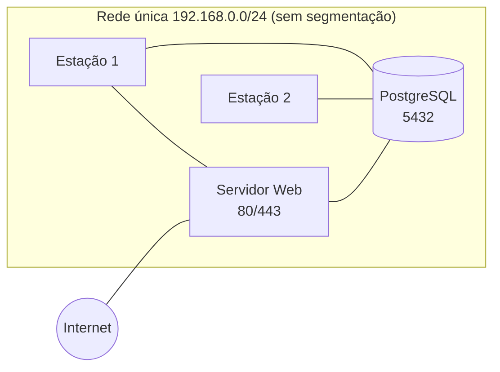
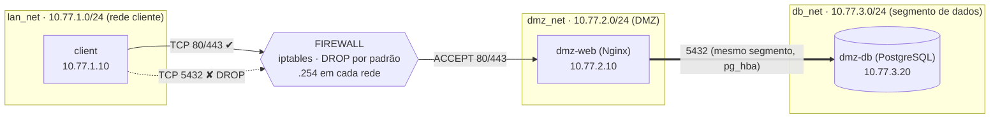

# Relatório Técnico — Firewall Linux, Arquitetura Netfilter & Iptables

**Instituição:** Instituto Federal Goiano — Campus Ceres
**Curso:** Bacharelado em Sistemas de Informação
**Disciplina:** Segurança da Informação
**Docente:** Prof. Roitier Campos Gonçalves
**Discente:** Matheus Felipe
**Modalidade:** Individual · **Valor:** 2,0 pontos · **Entrega:** 15/10/2026

---

## Sumário

1. [Definição do Case](#1-definição-do-case)
2. [Diagnóstico: Cenário Atual vs. Proposta de Solução](#2-diagnóstico-cenário-atual-vs-proposta-de-solução)
3. [Matriz de Regras de Segurança (Firewall)](#3-matriz-de-regras-de-segurança-firewall)
4. [Metodologia de Testes e Validação](#4-metodologia-de-testes-e-validação)

---

## 1. Definição do Case

### 1.1 Descrição da empresa

O estudo de caso é uma situação **hipotética baseada na realidade** de pequenas
empresas de comércio eletrônico do interior do Brasil.

A **CerradoShop** é uma loja virtual de produtos regionais (doces, cafés
especiais, artesanato) sediada em Ceres-GO. Ela tem cerca de 25 colaboradores,
divididos entre atendimento, financeiro, logística e administração. A empresa
cresceu rápido nos últimos dois anos: começou vendendo por redes sociais e hoje
recebe pedidos diretamente pelo próprio site.

A infraestrutura de TI foi montada de forma improvisada, conforme a necessidade
surgia, e hoje é mantida por uma única pessoa, sem uma política formal de
segurança.

### 1.2 Contexto do negócio

O site é a principal fonte de receita: um pedido que não entra por indisponibilidade
do site é uma venda perdida. Ao mesmo tempo, o banco de dados guarda **dados
pessoais de clientes** (nome, e-mail, endereço, histórico de compras), o que
traz obrigações da **LGPD (Lei nº 13.709/2018)** — em especial o dever de adotar
medidas técnicas para proteger esses dados contra acessos não autorizados
(art. 46).

Os pontos de negócio que guiam as decisões deste trabalho são:

- **Disponibilidade** do site para clientes e funcionários.
- **Confidencialidade** dos dados de clientes guardados no banco.
- **Controle de acesso** — cada tipo de usuário deve alcançar apenas o que
  precisa para trabalhar.

### 1.3 Serviços que precisam operar

| Serviço | Tecnologia | Quem acessa | Porta |
|---|---|---|---|
| Loja virtual / painel administrativo | Nginx (HTTP e HTTPS) | Funcionários (rede interna) e clientes | TCP 80 e 443 |
| Banco de dados de produtos e pedidos | PostgreSQL 16 | **Somente** o servidor web | TCP 5432 |
| Estações de trabalho dos funcionários | Alpine Linux (simulação) | Usam o site; não administram o banco | — |
| Gateway / firewall de borda | Linux + iptables | Infraestrutura (ninguém acessa serviços nele) | — |

> **Nota sobre a simulação:** o site seria exposto à internet em produção.
> Neste laboratório, o acesso do público externo é representado pela rede
> cliente (LAN), que é a origem de tráfego que o firewall precisa filtrar. A
> mesma lógica de regras vale para qualquer origem não confiável.

---

## 2. Diagnóstico: Cenário Atual vs. Proposta de Solução

### 2.1 Cenário atual (problemas mapeados)

Hoje a CerradoShop opera com uma **rede plana**: estações, servidor web e
servidor de banco de dados estão no mesmo segmento, ligados ao mesmo switch e
ao mesmo roteador de internet. Não existe firewall interno.

| # | Problema mapeado | Risco / impacto para o negócio |
|---|---|---|
| P1 | **Falta de segmentação**: estações, web e banco no mesmo segmento. | Uma estação comprometida (por exemplo, por *phishing*) enxerga todos os servidores. Facilita a **movimentação lateral** do invasor. |
| P2 | **Banco de dados acessível por qualquer máquina da rede** na porta 5432. | Qualquer funcionário (ou malware) pode tentar força bruta ou explorar uma falha do PostgreSQL. Risco direto de **vazamento de dados pessoais** (LGPD). |
| P3 | **Ausência de controle de acesso** entre as zonas: nenhuma regra define quem fala com quem. | Não há como aplicar o princípio do **menor privilégio**; também não há trilha de auditoria do que foi bloqueado. |
| P4 | **Todas as portas dos servidores ficam abertas** para a rede (serviços de teste, portas de administração esquecidas). | Superfície de ataque maior que o necessário: um `nmap` mostra tudo que está escutando. |
| P5 | **Sem política *deny-by-default***: o que não foi proibido é permitido. | Qualquer serviço novo instalado fica exposto automaticamente, sem passar por revisão. |
| P6 | **Gargalo e ponto único de falha**: tráfego de estações e de clientes disputa o mesmo segmento e o mesmo roteador. | Um problema de rede ou ataque de negação de serviço afeta todos os sistemas ao mesmo tempo. |
| P7 | **Web e banco sem isolamento de privilégios**: o servidor web tem as mesmas permissões de rede que as estações. | Se o servidor web for explorado, o atacante alcança a rede inteira. |

### 2.2 Proposta de solução

A proposta é separar a infraestrutura em **três zonas** e colocar um **firewall
Linux (Netfilter/iptables)** como único caminho de comunicação entre a rede
interna e os servidores. Toda a arquitetura é simulada no Docker Compose com
redes `bridge` isoladas.

#### Endereçamento

| Rede (Compose) | Sub-rede | Membros |
|---|---|---|
| `lan_net` | 10.77.1.0/24 | `client` (.10) · `firewall` (.254) |
| `dmz_net` | 10.77.2.0/24 | `web` (.10) · `firewall` (.254) |
| `db_net`  | 10.77.3.0/24 | `web` (.10) · `db` (.20) · `firewall` (.254) |

#### Justificativas das decisões de arquitetura

| Decisão | Por quê |
|---|---|
| **Segmentar em DMZ** (resolve P1, P7) | O servidor web é o componente mais exposto. Isolando-o em uma zona própria, se ele for comprometido o atacante não ganha acesso automático à rede interna nem ao banco. |
| **Banco de dados em segmento próprio (`db_net`)** (resolve P2) | O banco guarda os dados mais sensíveis. Ele só compartilha rede com o servidor web e com o firewall. As estações **não têm caminho direto** até ele. |
| **Política `DROP` por padrão** nas cadeias INPUT, FORWARD e OUTPUT (resolve P4, P5) | Inverte a lógica: só passa o que foi liberado explicitamente. Um serviço novo ou esquecido fica automaticamente inacessível. |
| **Firewall *stateful*** (`conntrack`: ESTABLISHED, RELATED) | Libera as respostas de conexões já autorizadas sem abrir portas de entrada. Pacotes `INVALID` são descartados. |
| **Liberação mínima: apenas TCP 80/443 da LAN para o web** (resolve P3) | É exatamente o que o negócio precisa (usar o site). Cada regra tem justificativa na [matriz da seção 3](#3-matriz-de-regras-de-segurança-firewall). |
| **Web é o único elo com o banco**, validado também no `pg_hba.conf` (defesa em profundidade) | Mesmo que alguém alcançasse a porta 5432, o PostgreSQL só aceitaria o usuário da aplicação vindo do IP do web. |
| **Anti-spoofing na interface da LAN** | Descarta pacotes que chegam pela LAN com IP de origem de outra rede, evitando que um cliente forje o endereço de uma zona confiável. |
| **NAT (`MASQUERADE`) apenas LAN → DMZ** | Os servidores respondem ao firewall sem precisar de rotas de retorno nem de `NET_ADMIN`. Assim, só o firewall tem privilégio administrativo sobre a rede (**menor privilégio**). |
| **Rede `internal: true`** nas três redes | O laboratório fica fechado: nenhum container alcança a internet ou o host por engano, e o único caminho entre zonas é o firewall. |
| **Regras carregadas automaticamente no `entrypoint.sh`** | O ambiente é reproduzível: `docker compose up -d` já sobe o firewall configurado, sem passos manuais. |

#### Como o problema mapeado se resolve

| Problema | Como a solução resolve |
|---|---|
| P1 Falta de segmentação | Três redes separadas; o firewall é o único roteador. |
| P2 Banco acessível a todos | Regra de `DROP` LAN → DB, banco em rede própria e `pg_hba.conf` restrito. |
| P3 Sem controle de acesso | Matriz de regras explícita (seção 3). |
| P4 Portas abertas | Só 80/443 chegam ao web; qualquer outra porta é descartada. |
| P5 Sem *deny-by-default* | Política `DROP` em todas as cadeias. |
| P6 Gargalo / ponto único | Tráfego de cada zona fica em seu próprio segmento; o firewall permite limitar e priorizar fluxos. |
| P7 Web sem isolamento | Web na DMZ, sem permissão de iniciar conexões para a LAN. |

---

## 3. Matriz de Regras de Segurança (Firewall)

As regras estão em [`firewall/rules.sh`](../firewall/rules.sh) e são carregadas
automaticamente pelo `entrypoint.sh` sempre que o container do firewall sobe.
O rótulo da primeira coluna aparece no `--comment` de cada regra do iptables,
o que permite localizá-la com `iptables -L -n -v`.

### 3.1 Política padrão (base do modelo *deny by default*)

| Cadeia | Política | Significado |
|---|---|---|
| `INPUT` (tráfego **para** o firewall) | **DROP** | O firewall não oferece serviço algum, exceto o ping de diagnóstico (I1). |
| `FORWARD` (tráfego **através** do firewall) | **DROP** | Nada passa entre as zonas sem regra explícita. |
| `OUTPUT` (tráfego **gerado** pelo firewall) | **DROP** | Apenas respostas a conexões já aceitas. |
| IPv6 (as três cadeias) | **DROP** | O laboratório não usa IPv6; nada é liberado. |

### 3.2 Regras de passagem entre zonas (cadeia `FORWARD`)

| Rótulo | Origem | Destino | Porta / Protocolo | Ação | Justificativa do negócio |
|---|---|---|---|---|---|
| S1 | LAN, com IP de origem **fora** de `10.77.1.0/24` | Qualquer | Qualquer | **DROP** | Anti-spoofing: impede que alguém na LAN forje o IP de outra zona. |
| — | Qualquer | Qualquer | Pacotes `INVALID` (conntrack) | **DROP** | Pacotes malformados ou fora de sequência não pertencem a nenhuma conexão legítima. |
| — | Qualquer | Qualquer | Pacotes `ESTABLISHED, RELATED` | **ACCEPT** | Permite as **respostas** das conexões já autorizadas (firewall *stateful*). |
| R1 | Rede Cliente (`10.77.1.0/24`) | DMZ — Web (`10.77.2.10`) | TCP **80** (`NEW`) | **ACCEPT** | Funcionários acessam a loja/painel por HTTP. |
| R2 | Rede Cliente | DMZ — Web | TCP **443** (`NEW`) | **ACCEPT** | Acesso seguro (HTTPS) ao sistema. |
| R3 | Rede Cliente | DMZ — Web | ICMP *echo-request*, máx. 10/s | **ACCEPT** | Diagnóstico de disponibilidade do site pela equipe de TI, com limite de taxa contra inundação. |
| R4 | Rede Cliente | DMZ — Banco (`10.77.3.20`) | TCP **5432** | **DROP** (+log) | Estação de trabalho **não deve acessar o banco direto**: protege os dados pessoais (LGPD). |
| R5 | Rede Cliente | Segmento do banco (`db_net`), qualquer outra coisa | Qualquer | **DROP** (+log) | Fecha atalhos, como alcançar o web pelo seu IP do segmento do banco (`10.77.3.10`). |
| R6 | Rede Cliente | DMZ, demais portas/protocolos | Qualquer (SSH 22, 3306, 8080…) | **DROP** (+log) | Reduz a superfície de ataque: só 80/443 são serviços do negócio. |
| R7 | DMZ | Rede Cliente | Qualquer (novas conexões) | **DROP** (+log) | Servidor web comprometido não consegue iniciar ataques contra as estações. |
| R8 | Segmento do banco | Qualquer destino | Qualquer (novas conexões) | **DROP** (+log) | O banco nunca inicia conexões: impede exfiltração de dados e *reverse shell*. |
| R9 | DMZ | Segmento do banco, **via firewall** | Qualquer | **DROP** (+log) | O web conversa com o banco diretamente em `db_net` (mesmo segmento), então nada precisa cruzar o firewall nesse caminho. |
| R10 | Qualquer | Qualquer | Qualquer | **DROP** (+log) | Regra final explícita; equivale à política, mas gera registro e contador. |

### 3.3 Regras do próprio firewall (cadeia `INPUT`) e NAT

| Rótulo | Origem | Destino | Porta / Protocolo | Ação | Justificativa do negócio |
|---|---|---|---|---|---|
| S1 | LAN com IP forjado | Firewall | Qualquer | **DROP** | Mesmo anti-spoofing aplicado ao tráfego destinado ao gateway. |
| I1 | Rede Cliente | Firewall (gateway) | ICMP *echo-request*, máx. 10/s | **ACCEPT** | Permite testar se o gateway está no ar. |
| I2 | Qualquer | Firewall | Qualquer outra coisa | **DROP** (+log) | O firewall não deve ter nenhum serviço exposto (SSH, HTTP…): reduz a superfície de ataque. |
| N1 | Rede Cliente | Saída pela interface da DMZ | Qualquer | **MASQUERADE** (NAT) | O web responde direto ao firewall, sem rota de retorno e sem `NET_ADMIN` nos servidores (menor privilégio). A filtragem ocorre **antes** do NAT, então as regras enxergam o IP real do cliente. |

### 3.4 Matriz resumida entre as zonas

| Origem ↓ / Destino → | Rede Cliente (LAN) | DMZ — Web | Segmento do banco |
|---|---|---|---|
| **Rede Cliente (LAN)** | — | ✅ TCP 80, 443 e ping | ❌ bloqueado |
| **DMZ — Web** | ❌ não inicia conexões | — | ✅ TCP 5432 direto em `db_net` (restrito pelo `pg_hba.conf`) |
| **Segmento do banco** | ❌ não inicia conexões | ❌ não inicia conexões | — |

> **Defesa em profundidade:** o acesso do web ao banco é limitado por duas
> camadas independentes: (1) o banco está em um segmento isolado, sem caminho
> a partir da LAN; (2) o `pg_hba.conf` só aceita o usuário `loja_app`, vindo do
> IP `10.77.3.10`, com senha criptografada (`scram-sha-256`).
